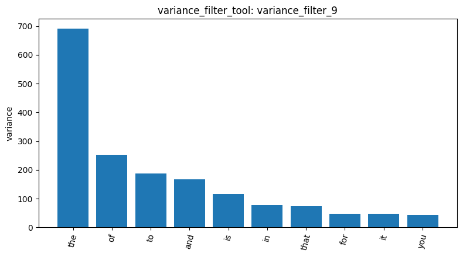
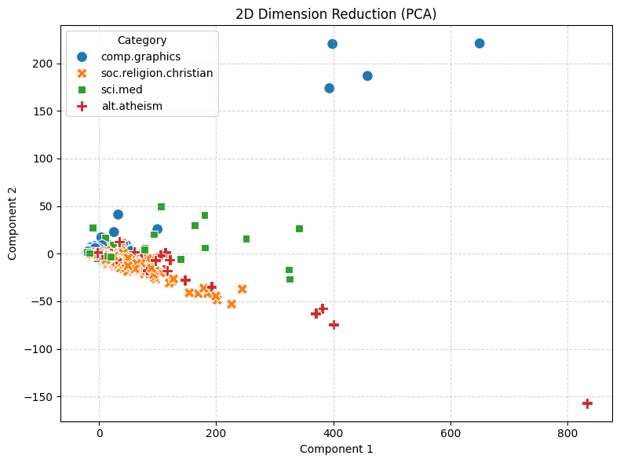
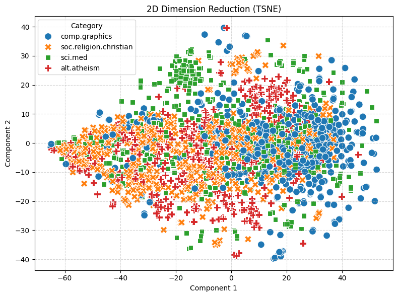
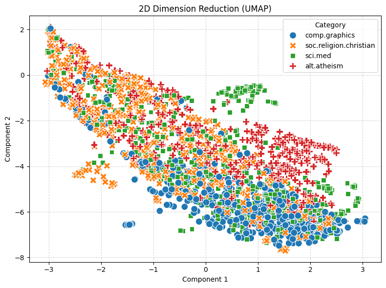

# Your report

**Main finding.** On the raw term-count representation, the four newsgroups cannot be separated, and the reason is not the topics themselves but what dominates the vocabulary: email headers, stop words and document length. I reached this conclusion from four independent pieces of evidence, described below. The dataset has 2,257 documents (480, 584, 594 and 599 per category; `load_dataset_1`), with no missing text and no exact duplicates (`check_missing_3`, `check_duplicates_4`).

**The vocabulary is dominated by non-topical words.** The document-term matrix has 35,788 terms and is 99.547% sparse (`build_dtm_6`), which is normal for text. However, the most frequent terms are generic stop words such as "the", "of" and "to" (`term_frequency_7`), and every document starts with email headers (From, Subject, Organization, Lines), visible in the data preview (`inspect_data_2`). The pattern mining results confirm the effect. With variance filtering and FP-Growth (min_sup 14, taken from the course reference notebook), alt.atheism gave 8,635 patterns (`mine_patterns_14`), comp.graphics 783 (`mine_patterns_15`), sci.med 6,015 (`mine_patterns_16`) and soc.religion.christian 10,609 (`mine_patterns_17`). The top patterns of the alt.atheism (`mine_patterns_18`) were header or formatting words (lines, subject, organization, edu, writes), with "lines" and "subject" at a support of 480, equal to the size of the category. A TF-IDF run (`mine_patterns_18`, min_sup 80, 4,183 patterns) showed the same picture. 

**No single term identifies a category, and filtering does not fix this.** A variance filter at threshold 0.01 kept 5,354 of 35,788 terms (`variance_filter_9`, bar chart: ). It removes very rare terms but keeps high-count stop words, because their counts vary a lot between documents, so it is not a topic filter. For alt.atheism, no term reached a Pearson correlation of 0.5 with the category (`pearson_filter_10`, 0 terms kept), and only 333 terms reached 0.1 (`pearson_filter_11`); Spearman at 0.1 kept 398 (`spearman_filter_12`). Individual terms are therefore only weakly associated with the category, which is consistent with topics being spread across many words.

**The projections show heavy overlap, and the dominant direction looks like document length.** In the PCA plot (`reduce_dimensions_19`, ) the first two components explain 65.94% and 4.33% of the variance. In my reading of the plot, almost all documents sit near the origin while about ten extreme points, mostly comp.graphics and one alt.atheism, stretch the axes. Since `describe_data_5` shows a few extremely long posts, my interpretation is that the first component mostly measures document length; I did not verify this by matching the outliers to document lengths. t-SNE (`reduce_dimensions_20`) and UMAP (`reduce_dimensions_21`)  
, both with random_state 42, also show strongly overlapping categories. UMAP is slightly more structured, with a small, almost pure sci.med cluster and a band of alt.atheism points, while t-SNE only shows a weak drift of comp.graphics to one side. 

**Cosine similarity confirms the same problem, and what I would change.** Two comp.graphics documents (0 and 1) have a cosine similarity of 0.3532 (`cosine_similarity_23`), barely higher than a comp.graphics and a soc.religion.christian document (0 and 2) at 0.3399 (`cosine_similarity_24`). In a representation that captured topic, the same-category pair should score clearly higher; here shared stop words and headers produce a background similarity of about 0.34 for any pair. This is only one pair per case, so it is an illustration, not a statistical test. The one-hot label matrix is 2,257 × 4 (`binarize_labels_22`). To make the categories separable I would first remove headers and stop words, then use TF-IDF or length normalization, and only then repeat the filtering, mining and dimensionality reduction.
