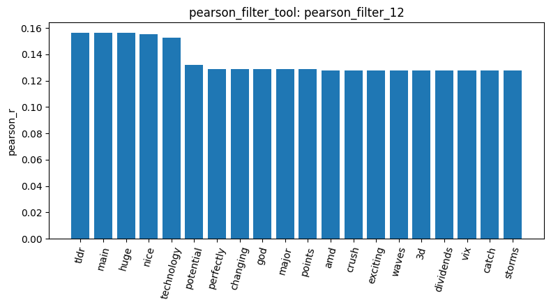
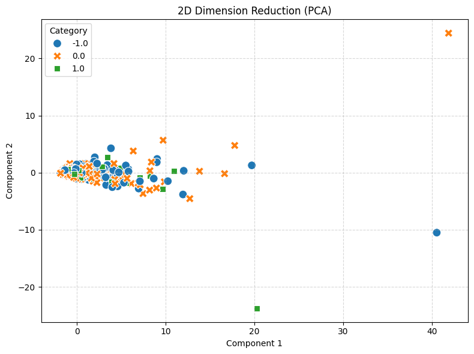
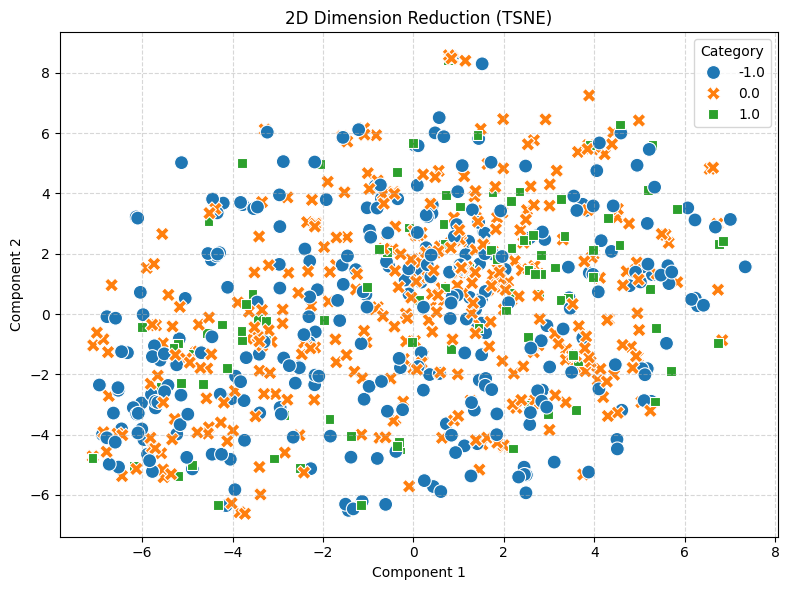
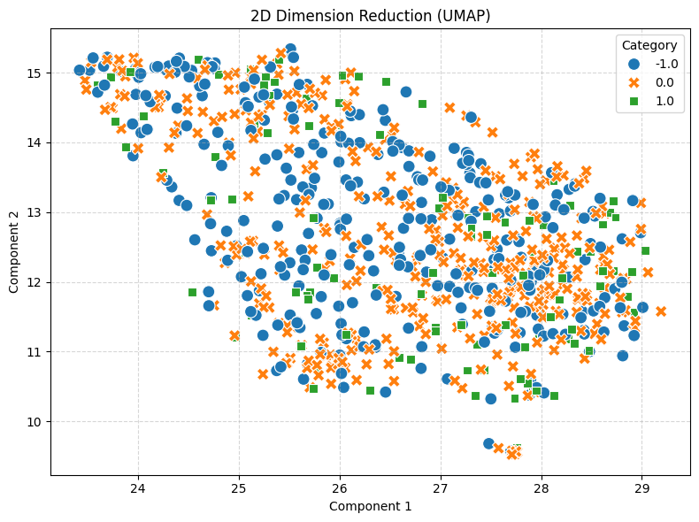

# Your report

**Main finding.** On this dataset, raw word counts carry very little sentiment signal: every method I ran (correlation filters, frequent patterns, three dimensionality reductions and cosine similarity) failed to separate negative (-1.0), neutral (0.0) and positive (1.0) comments. The file has 813 comments with 315 negative, 391 neutral and 107 positive (`inspect_data_6`), and no missing text (`check_missing_2`) after removing 23 duplicated rows (`check_duplicates_4`). The comments are short, with mean lengths of about 165, 153 and 138 characters for the positive, negative and neutral classes (`describe_data_7`), and this shortness explains most of what follows.

**The vocabulary is small, sparse and dominated by function words.** The document-term matrix has 813 documents, 4,313 terms and 99.5249% sparsity (`build_dtm_8`). The most frequent terms are generic words such as "the", "to", "and", "is" and "it" (`term_frequency_9`), and the variance chart shows the same thing: the top 20 terms by variance are all stop words, with "the" far above the rest (`variance_filter_11`) 

. 

A variance threshold of 0.01 kept 490 and removed 3,823 terms, so it removes rare words but not stop words, because their counts vary a lot between comments. This is a property of the raw-count representation, not a tool error.

**No single word is a strong sentiment indicator.** For the positive class, the Pearson filter found 41 terms with r of at least 0.1 (`pearson_filter_12`) and the Spearman filter 39 (`spearman_filter_13`); for the negative class only 18 terms passed (`pearson_filter_14`). In the bar chart of `pearson_filter_12` 

() 

the highest correlation is only about 0.156, and the top words mix plausible positive words (nice, huge, exciting) with incidental ones (main, points, 3d, storms), which I read as rare words that happen to occur in a few positive comments. Frequent pattern mining points the same way. The newsgroup setting of minimum support 14 found no pattern for the neutral class (`mine_patterns_16`), and I had to lower it to 6 (29 patterns, `mine_patterns_17`), 5 for the negative class (65, `mine_patterns_18`) and 3 for the positive class (60, `mine_patterns_19`). Every pattern was a single word with support between 3 and 9, and some words such as "better" appear among the top patterns of both the positive and the negative class. Because the thresholds differ per class, the pattern counts are not directly comparable, and a top-k rerun (`mine_patterns_20` to `mine_patterns_22`) returned essentially the same top words.

**The projections show no class structure.** In the PCA plot (`reduce_dimensions_23`), 

 

nearly all points sit in one small region on the left, completely overlapping, while a few extreme points stretch the axes; my guess is that these are unusually long comments. The t-SNE plot (`reduce_dimensions_24`), 

 

is a single round cloud with the three classes mixed, and the UMAP plot (`reduce_dimensions_25`), 

is a diagonal band, also mixed. I interpreted these plots myself, because the analysis agent only sees the tool summaries, not the images. Mixing in the plot does not prove that sentiment is unrecoverable, only that these count features do not expose it.

**Cosine similarity shows what drives the scores.** Two negative comments (documents 0 and 4) scored 0.0 (`cosine_similarity_28`), as did a negative and a neutral comment (`cosine_similarity_27`), while two neutral comments (documents 1 and 2) scored 0.2004 (`cosine_similarity_29`). My reading is that a score is zero when two short comments share no words, and positive when they happen to share function words, independent of sentiment. These are three single pairs, so they illustrate the problem but are not a statistical test. Next step, I would remove the stopwords from the beginning to see the results. However, in the short text dataset like Reddit, maybe it's not a proper way to remove stopwords in early stages.

**Generative AI Usage.** I use AI to translate and refine the report.